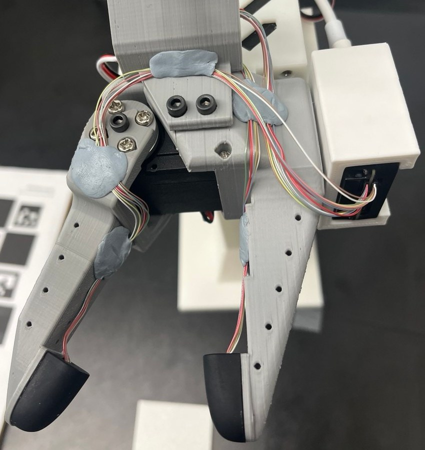

# lerobot-paxini

LeRobot plugins for [Paxini](https://www.paxini.com/) PX-6AX GEN3 tactile sensors. Both install on stock [lerobot](https://github.com/huggingface/lerobot) (0.6.1 or later) with no changes to lerobot itself, via its third-party plugin discovery.

| Package | PyPI | What it does |
|---|---|---|
| [lerobot_camera_paxini](lerobot_camera_paxini/) | `pip install lerobot_camera_paxini` | Any GEN3 sensor (9 to 239 taxels) as a LeRobot camera. Force-vector or heatmap images, both communication boards. |
| [lerobot_robot_so101_paxini](lerobot_robot_so101_paxini/) | `pip install lerobot_robot_so101_paxini` | SO-101 follower arm with GEN3 fingertips. Tactile as float32 state features alongside normal cameras. |

The camera plugin is listed in LeRobot's [third-party sensors documentation](https://huggingface.co/docs/lerobot/main/en/third_party_sensors).

Both build on [paxini-sdk](https://github.com/Jingyi-Z/paxini-sdk) (`pip install paxini-sdk`), a pure-Python driver for the GEN3 communication boards.

## Which one do you want

Use the camera plugin when tactile should enter your pipeline as images: it works with any robot, shows up in visualizers like any camera, and image-based policies consume it unchanged. Use the robot plugin when exact per-taxel force values matter: floats survive storage losslessly, while the camera path quantizes to uint8 and the default video codec is lossy on top.

## Quick start, camera

```bash
pip install lerobot paxini-sdk lerobot_camera_paxini
```

```bash
lerobot-record \
  --robot.type=so101_follower --robot.port=/dev/ttyACM0 --robot.id=follower \
  --robot.cameras='{tactile: {type: paxini, port: /dev/ttyACM1, module_index: 14, width: 240, height: 320, fps: 30}}' \
  ...
```

## Quick start, robot

```bash
pip install lerobot paxini-sdk lerobot_robot_so101_paxini
```

See each package's `docs/USER_GUIDE.md` for configuration and troubleshooting and `docs/TECHNICAL.md` for design notes. `smoke_camera.py` is a hardware smoke test for the camera plugin that needs no lerobot environment.

## Hardware

Printable SO-101 jaws with seats for two DP-S2015-Elite fingertips, plus a full build and wiring guide, are in [hardware/](hardware/INSTALL.md).



## License

Apache-2.0.
