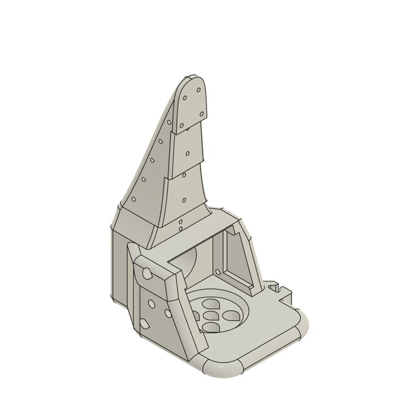
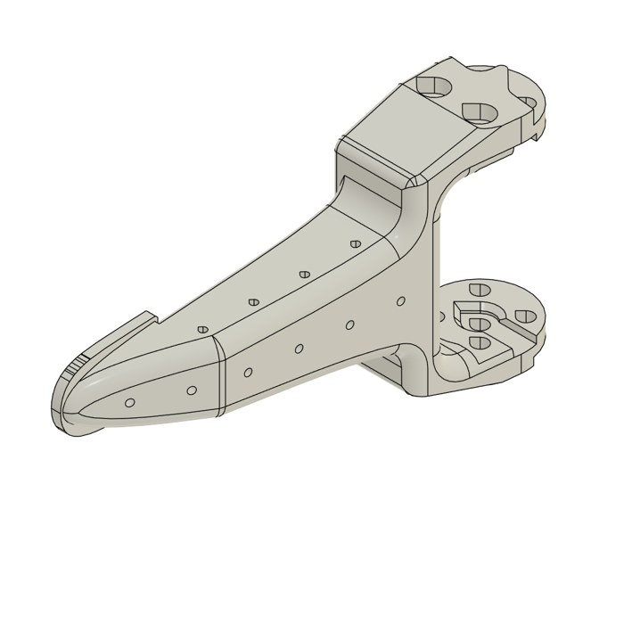

# Hardware: tactile SO-101 gripper

How to build the SO-101 gripper used with these plugins: two Paxini PX-6AX GEN3 fingertips, one on each jaw, read through the Paxini high-speed communication board.


The two jaws are modified from the original SO-101 parts by [TheRobotStudio](https://github.com/TheRobotStudio/SO-ARM100) (Apache-2.0) and are released here under the same license. They replace two stock parts one for one, so the rest of the SO-101 build is unchanged.

| File | Replaces stock part | What changed |
|---|---|---|
| `so101_paxini_fixed_jaw_wrist_roll.stl` / `.3mf` | Wrist Roll Follower (the fixed jaw is part of it) | Fingertip seat with four pin holes at the jaw tip |
| `so101_paxini_moving_jaw.stl` / `.3mf` | Moving Jaw | Fingertip seat with four pin holes at the jaw tip |

| Fixed jaw (wrist roll) | Moving jaw |
|---|---|
|  |  |

**The seats fit the DP-S2015-Elite fingertip only.** The plugins work with every GEN3 variant, but other fingertips need their own jaw geometry.

---

## 1. What you need

| Item | Qty | Notes |
|---|---|---|
| SO-101 follower arm | 1 | Standard build, minus the two stock parts above |
| Paxini PX-6AX GEN3 fingertip, DP-S2015-Elite | 2 | 52 taxels each |
| Paxini high-speed communication board | 1 | One USB connection serves both fingertips |
| Fingertip cables to the board | 2 | Supplied with the sensors |
| Metal pins, 1.5 mm diameter, 4 to 6 mm long | 8 | Four per fingertip. Optional but recommended, for example [these](https://www.amazon.com/dp/B0G8HSJDVK) |
| Superglue (cyanoacrylate) | 1 | |

## 2. Print the jaws

PLA, with the same settings the [SO-101 build](https://github.com/TheRobotStudio/SO-ARM100) recommends for its own parts: 0.4 mm nozzle at 0.2 mm layer height, 15% infill, supports everywhere except slopes steeper than 45 degrees, and no supports inside horizontal screw holes. The `.3mf` files load directly into a slicer. The `.stl` files are the same meshes.

## 3. Attach the fingertips

The fingertip is glued to the jaw. Gluing only at four pins locates it precisely and still lets you remove it later, which gluing the whole contact face would not.

1. Push four pins into the four holes on the back of the fingertip.
2. Dry-fit: the pins go into the matching four holes in the jaw seat. Check that the fingertip sits flush and square.
3. Take it off, put a small drop of superglue in the gap around each pin, and press the fingertip back into place.
4. **Do not stretch the fingertip's skin while it sets.** A skin glued under tension reads as a constant nonzero force from the very first frame. Hold it lightly in position, do not squeeze or pull it.
5. Repeat for the second jaw.

Without pins, a thin layer of superglue on the seat works too, but placement is less repeatable and the fingertip is hard to remove.

## 4. Assemble and route the cables

1. Build the arm as usual, using the two printed jaws in place of the stock Wrist Roll Follower and Moving Jaw.
2. Run each fingertip cable back along its jaw to the board. Fix the cables to the jaw (the photo uses reusable adhesive putty) so they never tug on the fingertip.
3. Open and close the gripper through its full range by hand before powering anything. The cables must not pull or pinch at either end of the stroke.

## 5. Wire and check the board

1. Plug both fingertip cables into the high-speed board, then connect the board to the computer over USB.
2. Find its port:

   ```bash
   pip install paxini-sdk
   paxini list
   ```

3. Check that both fingertips are seen and respond:

   ```bash
   paxini-smoke --port /dev/ttyACM1 --duration 10
   ```

   The output lists the active modules. Each fingertip occupies one module position on the board, reported as a name such as `Th-T` or `Mi-T`. The plugins take the matching index:

   | Name | Index | Name | Index |
   |---|---|---|---|
   | Th-T | 2 | Ri-T | 14 |
   | Ix-T | 6 | Li-T | 18 |
   | Mi-T | 10 | | |

   Press each fingertip during the stream and write down which index is the fixed jaw and which is the moving jaw.

4. **If you plug or unplug a fingertip while the board is powered, power-cycle the board.** It only detects modules at startup, so a newly connected fingertip is invisible or reads zeros until it restarts.

## 6. Check the rest reading

With the gripper open and nothing touching either pad, the resting force should be zero or within a few counts of it. A steady offset on one fingertip (around 1 N or more) usually means the skin was glued under tension or something presses on the pad. Small offsets that stay constant are harmless for learning, but subtract a per-episode pre-contact baseline in any force analysis.

## 7. Use it with the plugins

```bash
pip install lerobot paxini-sdk lerobot_camera_paxini lerobot_robot_so101_paxini
```

Camera plugin, one camera per fingertip:

```bash
lerobot-record \
  --robot.type=so101_follower --robot.port=/dev/ttyACM0 --robot.id=follower \
  --robot.cameras='{
      tactile_fixed:  {type: paxini, port: /dev/ttyACM1, module_index: 10, width: 240, height: 320, fps: 30},
      tactile_moving: {type: paxini, port: /dev/ttyACM1, module_index: 2,  width: 240, height: 320, fps: 30}}' \
  ...
```

Robot plugin, tactile as float state features:

```bash
lerobot-record \
  --robot.type=so101_paxini --robot.port=/dev/ttyACM0 --robot.id=follower \
  --robot.sensors='{paxini_fingertip: {port: /dev/ttyACM1, module_indices: [10, 2]}}' \
  ...
```

Use your own indices from section 5. The order of `module_indices` is the fingertip order in `observation.state`, so pick one order (fixed jaw first is a good convention) and keep it for every dataset you record.

## 8. Troubleshooting

| Symptom | Cause and fix |
|---|---|
| A fingertip reads zeros or is missing | Power-cycle the board after any cable change (section 5, step 4) |
| Port busy or cannot be opened | Another program holds the board. Only one process can read it at a time |
| Constant force at rest | Skin glued under tension, or the mount presses on the pad (section 6). Re-glue with the skin relaxed |
| Forces look swapped between jaws | Index order in your config differs from the physical jaws. Recheck with the press test in section 5 |
| Fingertip needs replacing | Only the four pin points are glued, so the fingertip lifts off the seat without damaging the jaw |
